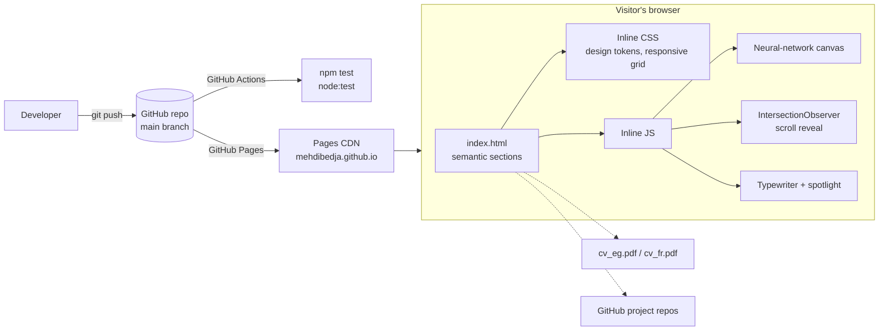

# Portfolio

Personal portfolio of Mahdi Bedja, AI Engineer (computer vision, speech recognition, LLMs & Agentic RAG), based in Paris.

Live site: https://mehdibedja.github.io

## What it does

A fast, single-page portfolio with no dependencies that presents:

- About: profile summary and key results (93.8% mAP@50, 3% WER, 14 lung pathologies)
- Experience: AI Engineer at BM TECH (medical imaging, medical ASR, Agentic RAG), Engineering Intern at CM Consulting
- Projects: featured mobile pest detection system plus other projects, linked to their GitHub repositories
- Skills & education: Sorbonne Paris Nord (M2 Intelligent Systems), ESI Algiers
- Contact: email, LinkedIn and downloadable CV in English and French

Features:

- Animated neural-network canvas background that reacts to the cursor
- Cursor spotlight, typewriter tagline, scroll-reveal animations
- Fully responsive, with a mobile menu (`aria-expanded`)
- Respects `prefers-reduced-motion`
- Open Graph metadata for rich link previews on LinkedIn and Slack
- Custom 404 page that redirects home

## Run it locally

No build step. Any static file server works:

```bash
git clone https://github.com/MehdiBedja/MehdiBedja.github.io.git
cd MehdiBedja.github.io
npm start            # serves on http://localhost:3000 (uses npx serve)
# or
python -m http.server 3000
```

## Tests

Tests use Node's built-in test runner and need no install:

```bash
npm test
```

They check metadata, that every in-page anchor resolves, unique ids, that referenced local files (CVs) exist, `rel="noopener"` on external links, alt text and aria labels, and that the inline JavaScript parses. GitHub Actions runs them on every push.

## Architecture



```
.
├── index.html            # the whole site: markup, styles and scripts
├── 404.html              # custom not-found page
├── cv_eg.pdf, cv_fr.pdf  # downloadable résumés (EN / FR)
├── tests/site.test.js    # static checks run by `npm test`
├── docs/screenshots/     # README images
└── .github/workflows/    # CI
```

## Contact

- Email: mahdibedja@gmail.com
- LinkedIn: [mahdi-bedja](https://www.linkedin.com/in/mahdi-bedja-0b94031b3/)
- GitHub: [@MehdiBedja](https://github.com/MehdiBedja)
